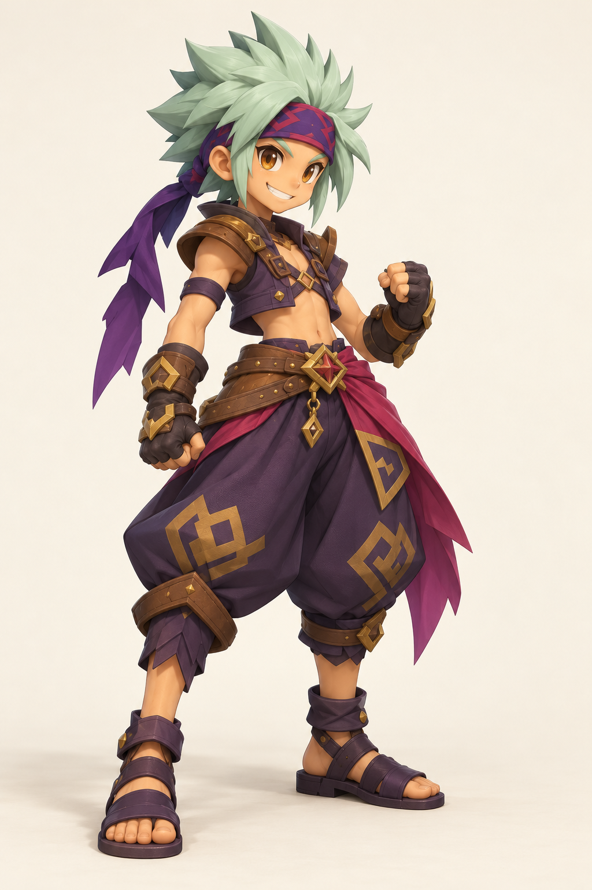

# Ryuu — cible de rendu stylisé

Le 15 octobre 2026, l’utilisateur a rejeté le premier pilote 3D procédural (« Horrible mdr »), puis réagi à cette nouvelle image : « c'est déjà vachement mieux ! ». Ce retour positif retient cette direction de rendu pour la suite ; il ne valide pas un maillage, une vue arrière ou les autres personnages.

## Provenance

Image raster produite par Imagegen intégré, à partir de la fiche originale `content/art/characters/reference-v2/references/ryuu.png`. Aucun modèle 3D n’a été produit par cette génération. [Prompt exact](prompt.txt) · [Empreintes](provenance.json) · [Comparaison](index.html).

Instructions de design consultées : [Claude Design communautaire](https://github.com/fol2/claude-design/tree/d98127be1c46425def44ac19c0cbfb6a5a1cfa9c), [Create Game Assets](https://github.com/gamedev-skills/awesome-gamedev-agent-skills/tree/0a70cfc64672d512c5b5b6006b5dcb5cf90dbdbd/skills/disciplines/create-game-assets). La génération est effectuée par Imagegen ; ces skills guident le travail, ils ne génèrent pas de géométrie.

## À conserver et à corriger

Conserver le visage expressif, les volumes continus, les mèches courbes, les grands plis et la distinction tissu/cuir/métal. La fiche originale reste l’autorité pour le costume : la pose du bras levé, les sangles du torse, certains ornements dorés et les proportions de cet essai divergent. Ne pas les transformer silencieusement en nouveau design canonique.

## Méthode reproductible

1. Identifier la fiche source et la base exacte ; lister les éléments d’identité à préserver.
2. Préparer une cible artistique séparée, conserver prompt et provenance, comparer à la source.
3. Construire un véritable modèle Blender de Ryuu masculin, en vérifiant silhouette puis visage, cheveux, costume et matières par des rendus comparables. Documenter les surfaces cachées reconstruites.
4. Présenter le modèle manipulable et ses rendus pour validation avant généralisation à Ryuu féminin puis aux autres héros ou monstres.
5. Après validation, vérifier les variantes, les cinq matériaux personnalisables, les matériaux fixes des équipements et l’export PNG dans l’atelier.

Le pilote interactif existant reste un prototype technique rejeté artistiquement. Cette image ne le remplace pas dans le canvas 3D.
